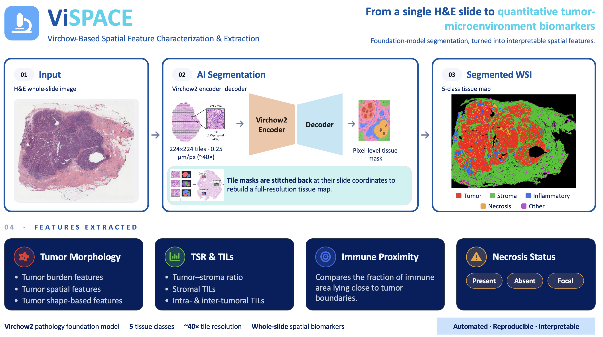

# ViSPACE — Virchow2 powered Spatial Characterization and feature Extraction Pipeline

ViSPACE is an end-to-end computational pathology pipeline for analyzing
whole-slide images (WSIs)in Lung Cancer and Breast Cancer. The pipeline combines the Virchow2 foundation
model with a pixel-wise segmentation decoder to generate five-class tissue
segmentations and extract quantitative spatial biomarkers from the Tumor
microenvironment (TME).

## Features

- End-to-end WSI analysis
- Virchow2-powered semantic segmentation
- Five tissue classes
  - Tumor
  - Stroma
  - Inflammatory (TILs)
  - Necrosis
  - Others
- Tumor ROI generation
- TSR and sTIL scoring
- Immune proximity analysis
- Necrosis proximity analysis
- Tumor morphology analysis


<p align="center">
  <br>
  <em>Detailed pipeline architecture — tessellation through spatial feature extraction</em>
</p>


---

---

# Documentation

Complete documentation is available in the **ViSPACE User Manual**.

---
# Recommended System Requirements

| Component | Recommended |
|-----------|-------------|
| Python | 3.11 |
| GPU | NVIDIA RTX 3080 / RTX 4090 / A5000 |
| CUDA | 12.1 |
| RAM | 32–64 GB |
| VRAM | ≥16 GB |
| Storage | SSD/NVMe |

ViSPACE was developed and tested using

- Python 3.11
- PyTorch 2.5.1
- CUDA 12.1
- NVIDIA RTX 4090 
---

## Table of Contents

0. [Prerequisites](#prerequisites)
1. [Overview](#overview)
2. [Quick Start](#quick-start)
3. [CLI Reference](#cli-reference)
4. [Running in a Jupyter Notebook](#running-in-a-jupyter-notebook)
5. [Pipeline Stages](#pipeline-stages)
6. [Configuration Reference](#configuration-reference)
7. [Output Directory Layout](#output-directory-layout)
8. [Feature Descriptions](#feature-descriptions)
9. [Running Subsets of Stages](#running-subsets-of-stages)
10. [Dependencies](#dependencies)
11. [Citation](#citation)
12. [License](#license)

---

## Prerequisites

Python **3.11** and, for GPU inference, an NVIDIA GPU with CUDA 12.1 (see
[Recommended System Requirements](#recommended-system-requirements)).

# Installation

ViSPACE is a pip-installable package. Any of the options below installs the
`vispace` package plus two console commands — `vispace` (run the pipeline) and
`vispace-check` (validate the environment).

### Option A — install from source *(recommended)*

```bash
# Create a new environment
conda create -n vispace python=3.11 -y

# Activate it
conda activate vispace

# Clone the repository
git clone https://github.com/himangi2003/ViSpace.git
cd ViSpace

# Install the matching PyTorch build
pip install torch==2.5.1+cu121 torchvision==0.20.1+cu121 \
    --extra-index-url https://download.pytorch.org/whl/cu121

# Install the package and its dependencies
pip install .
```

Use an **editable** install (`pip install -e .`) if you plan to modify the code —
changes take effect without reinstalling.

> **CPU-only / no CUDA?** Skip the explicit `torch` line and just run
> `pip install .`; pip resolves the default CPU build of `torch==2.5.1`.

### Option B — Conda environment

```bash
conda env create -f environment.yml
conda activate vispace
pip install .
```

### Option C — Google Colab

```bash
pip install -q -r requirements/colab.txt
pip install -q .
```

See **Chapter 1** of the User Manual for complete installation instructions.

---

# Hugging Face Authentication and Virchow 2 access

Virchow2 is a **gated model** — you need a HuggingFace account and access token before the weights can be downloaded (skip this entirely if you set `VIRCHOW2_PATH` to local weights instead).

Request access at <https://huggingface.co/paige-ai/Virchow2>

Authenticate once using

*Method A — CLI (recommended for servers & scripts):*

```bash
pip install huggingface_hub
huggingface-cli login
# Paste your token when prompted — input is hidden, this is expected
huggingface-cli whoami   # verify
```

To persist across sessions:

```bash
echo 'export HF_TOKEN=hf_your_token_here' >> ~/.bashrc   # or ~/.zshrc
source ~/.bashrc
```

*Method B — Jupyter notebook cell* (see `notebooks/ViSpace_tutorial.ipynb` for the full walkthrough):

```python
import os
from huggingface_hub import whoami

# ✏ Paste your HF access token here (Read role is sufficient)
HF_ACCESS_TOKEN = "hf_your_token_here"

user = whoami(token=HF_ACCESS_TOKEN)
print(f"Authenticated as: {user['name']}")

os.environ["HF_TOKEN"] = HF_ACCESS_TOKEN
print("HF_TOKEN environment variable set.")
```

Alternatively, local Virchow2 weights can be specified using
`VIRCHOW2_PATH`.

Complete instructions are provided in **Chapter 1** of the Vispace User Manual in docs.

---

# Model Weights

ViSPACE relies on two separate sets of weights:

1. **Virchow2 encoder** — the foundation model that embeds each tile. It is
   **not bundled**: download it from the gated Hugging Face repository
   [`paige-ai/Virchow2`](https://huggingface.co/paige-ai/Virchow2) (see
   *Hugging Face Authentication* above), or point `VIRCHOW2_PATH` at a local copy.
   Access is gated — first request it (free) on the model page at
   <https://huggingface.co/paige-ai/Virchow2> and authenticate with your Hugging
   Face token before the first run; the weights download automatically once granted.
2. **ViSPACE segmentation decoder** — the lightweight head that turns Virchow2
   features into the five-class tissue mask. Two trained checkpoints **ship
   inside the installed package** under `vispace/assets/weights/`, so no
   download is required:

   | Checkpoint | Trained on | Use for |
   |---|---|---|
   | `TNBC_best.pt` *(default)* | TCGA breast / TNBC (BCSS) | breast / general H&E |
   | `IGNITE_lung_best.pt` | IGNITE lung cohort | lung H&E |

**Selecting the decoder.** `CHECKPOINT` defaults to the bundled `TNBC_best.pt`.
To use the lung decoder (or your own `.pt`), set `CHECKPOINT` to its path.

*Python:*

```python
from pathlib import Path
import vispace
from vispace import PipelineConfig

weights = Path(vispace.__file__).parent / "assets" / "weights"

cfg = PipelineConfig(
    WSI_PATH   = "slides/your_lung_slide.svs",
    CHECKPOINT = str(weights / "IGNITE_lung_best.pt"),   # lung cohort
    # omit CHECKPOINT entirely to use the default TNBC_best.pt
)
```

*CLI:*

```bash
# print the bundled weights directory, then pass the checkpoint you want
python -c "import vispace, pathlib; print(pathlib.Path(vispace.__file__).parent / 'assets' / 'weights')"

vispace --wsi-path slides/your_lung_slide.svs \
        --checkpoint /path/to/vispace/assets/weights/IGNITE_lung_best.pt
```

---

# Environment Check (Optional)

Before processing any slide, verify the installation with the `vispace-check`
console command (installed with the package):

```bash
vispace-check                              # validate the current environment
vispace-check --from-json run_config.json  # also validate the paths in a saved config
```

This validates

- Python environment
- CUDA availability
- PyTorch installation
- Virchow2 dependencies
- Mussel installation
- Model checkpoints
- Output directories

See **Chapter 2** for further details.

# Running a Test

There is no unit-test suite yet — the pipeline's real test is an end-to-end run
on a slide. Use the checks below to confirm the install is wired up before
committing to a long run.

**1. Smoke test — package import, console commands, and bundled assets:**

```bash
# Run from any directory to prove nothing depends on the current folder.
python -c "import vispace; print('vispace', vispace.__version__)"
vispace --help
vispace-check
```

If `import vispace` succeeds and `vispace --help` prints the flag list, the
package, its dependencies, and the bundled model checkpoints are all resolvable.

**2. End-to-end test on a slide.** Place one whole-slide image under
`tests/data/`, then run the pipeline on it. Slides are large and should **not**
be committed — create the folder and git-ignore the slides:

```bash
mkdir -p tests/data
echo -e "*.tif\n*.svs" > tests/data/.gitignore   # keep large slides out of git
# copy or download a slide into tests/data/ (e.g. tests/data/test_slide.tif)
```

```bash
# fastest check: only the two stages that exercise the GPU + Virchow2 encoder
vispace --wsi-path tests/data/test_slide.tif --stages tessellation,segmentation

# or the full 8-stage pipeline
vispace --wsi-path tests/data/test_slide.tif --out-dir vispace_output
```

The tutorial notebook (`notebooks/ViSpace_tutorial.ipynb`) auto-discovers the
first slide in `tests/data/` — or set `VISPACE_WSI=/path/to/slide.tif` — so the
same test slide drives both the CLI and the notebook. To test the **lung**
decoder, add `--checkpoint <path>/IGNITE_lung_best.pt` (see *Model Weights*).

**3. Adding a formal test suite (optional).** `pytest` is the natural fit — put
tests under `tests/` and run them with an editable install:

```bash
pip install -e . pytest
pytest -q
```


## Overview

Vispace processes a WSI in eight sequential stages, orchestrated end-to-end by the `vispace` command (`vispace.run_vispace`):

| # | Stage | Module | Description |
|---|-------|--------|-------------|
| 1 | Tessellation | `vispace.tessellate` | Tile the WSI into 224×224 px patches using Mussel |
| 2 | Segmentation | `vispace.segmenter` | Run Virchow2 + pixel-wise decoder on every patch |
| 3 | Stitching | `vispace.stitch` | Merge per-patch masks into a slide-level GeoJSON |
| 4 | Tumor ROI Overlay | `vispace.tumor_roi_overlay` | Detect tumor islands and pick representative square ROI boxes |
| 5 | Cluster TSR / sTILs | `vispace.cluster_tils_tsr_scoring` | Compute TSR and sTILs per Tumor cluster |
| 6 | Immune Proximity | `vispace.immune_proximity_features` | TIL–Tumor boundary distance features |
| 7 | Necrosis Features | `vispace.necrosis_features` | Necrosis area, perimeter, and category per tumor region (Master ROI) |
| 8 | Tumor Morphology | `vispace.tumor_morphology_features` | Shape, fragmentation, and perimeter features per cluster |

**Segmentation classes:** Tumor · Stroma · Necrosis · Inflammatory (TILs) · Others

**Orchestration & utilities** (not pipeline stages themselves):

| Module | Purpose |
|---|---|
| `vispace.config` | Build and save a run configuration |
| `vispace.environment_check` | Pre-flight dependency / GPU / path validation |
| `vispace.run_vispace` | Runs all 8 stages, resumable, subset-capable |
| `vispace.generate_qmd_file` | Builds the Quarto `.qmd` report from a completed run |

---

## Quick Start

```python
from vispace import PipelineConfig, run_vispace

cfg = PipelineConfig(
    OUT_DIR  = "vispace_output",
    WSI_PATH = "slides/your_slide.svs",
    # CHECKPOINT defaults to the bundled TNBC model; set it to use your own .pt
)

results = run_vispace(cfg.WSI_PATH, cfg)

print(results["success"])          # True if all stages completed
print(results["total_elapsed_s"])  # Wall-clock seconds
```

To run every slide in a folder, loop over the files yourself and swap in each path — `WSI_PATH` is per-slide, not a folder setting:

```python
from pathlib import Path
from dataclasses import replace
from vispace import PipelineConfig, run_vispace

base_cfg = PipelineConfig(OUT_DIR="vispace_output")

for svs in Path("slides/").glob("*.svs"):
    cfg = replace(base_cfg, WSI_PATH=str(svs))
    run_vispace(str(svs), cfg)
```

---

## CLI Reference

> **Invocation after install.** The pipeline modules live inside the `vispace`
> package, so each is run as a module — **`python -m vispace.<name> …`** (e.g.
> `python -m vispace.tessellate`) — rather than as a loose script file. The two
> most common entry points also have console-command shortcuts installed on your
> `PATH`: the full pipeline is `vispace …` (= `python -m vispace.run_vispace`)
> and the environment check is `vispace-check …`.

All scripts share the same conventions: every field on `PipelineConfig` is available as a `--flag`, and every script accepts `--from-json run_config.json` to reuse a config saved once via `python -m vispace.config --print-config`. Run any script with `--help` to see its full flag list.

### 0. Build the config once

```bash
python -m vispace.config \
    --wsi-path slides/TCGA-A1-A0SP.svs \
    --print-config > run_config.json
# CHECKPOINT defaults to the bundled TNBC model; add --checkpoint path/to.pt to override
```

### 1. Pre-flight environment check *(recommended before a long run)*

```bash
vispace-check --from-json run_config.json
```

### 2. Authenticate with HuggingFace *(skip if using local Virchow2 weights)*

```bash
huggingface-cli login
```

### 3. Run the full pipeline in one command

```bash
vispace --from-json run_config.json
```

```bash
# run only a subset of stages (prerequisites must already exist)
vispace --from-json run_config.json \
    --stages cluster_tils_tsr_score,immune_proximity,necrosis_features

# force specific stages to re-run even if output exists
vispace --from-json run_config.json \
    --force-stages tumor_roi_overlay
```

**— or —** run each stage individually:

```bash
# 3a. tessellate
python -m vispace.tessellate --from-json run_config.json

# 3b. segment
python -m vispace.segmenter --from-json run_config.json
python -m vispace.segmenter --from-json run_config.json --batch-size 96   # override example

# 3c. stitch + GeoJSON
python -m vispace.stitch --from-json run_config.json
python -m vispace.stitch --from-json run_config.json --min-area-px 200    # override example

# 3d. tumor ROI clustering + overlay
python -m vispace.tumor_roi_overlay --from-json run_config.json
python -m vispace.tumor_roi_overlay --from-json run_config.json --roi-size-um 150

# 3e. cluster TSR / sTILs scoring
python -m vispace.cluster_tils_tsr_scoring --from-json run_config.json
python -m vispace.cluster_tils_tsr_scoring --from-json run_config.json --spatial-scoring-mode refine

# 3f. immune / TIL proximity features
python -m vispace.immune_proximity_features --from-json run_config.json
python -m vispace.immune_proximity_features --from-json run_config.json --immune-contact-tolerance-um 10

# 3g. necrosis features
python -m vispace.necrosis_features --from-json run_config.json

# 3h. tumor morphology features
python -m vispace.tumor_morphology_features --from-json run_config.json
python -m vispace.tumor_morphology_features --from-json run_config.json --morphology-min-island-area-um2 500
```


### Full command reference table

| # | Module | Purpose | Minimal command |
|---|---|---|---|
| 0 | `vispace.config` | Build + save the run config | `python -m vispace.config --wsi-path ... --print-config > run_config.json` |
| — | `vispace.environment_check` | Validate dependencies, GPU, paths before running | `vispace-check --from-json run_config.json` |
| 1 | `vispace.tessellate` | Tile the WSI (Mussel) | `python -m vispace.tessellate --from-json run_config.json` |
| 2 | `vispace.segmenter` | Run Virchow2 segmentation inference | `python -m vispace.segmenter --from-json run_config.json` |
| 3 | `vispace.stitch` | Stitch tiles → WSI canvas + GeoJSON | `python -m vispace.stitch --from-json run_config.json` |
| 4 | `vispace.tumor_roi_overlay` | Detect tumor islands, build representative ROI boxes | `python -m vispace.tumor_roi_overlay --from-json run_config.json` |
| 5 | `vispace.cluster_tils_tsr_scoring` | TSR + sTILs scoring per cluster | `python -m vispace.cluster_tils_tsr_scoring --from-json run_config.json` |
| 6 | `vispace.immune_proximity_features` | TIL proximity to tumor boundary | `python -m vispace.immune_proximity_features --from-json run_config.json` |
| 7 | `vispace.necrosis_features` | Necrosis area / perimeter / category per tumor region | `python -m vispace.necrosis_features --from-json run_config.json` |
| 8 | `vispace.tumor_morphology_features` | Tumor shape / fragmentation features | `python -m vispace.tumor_morphology_features --from-json run_config.json` |
| — | `vispace.run_vispace` | Orchestrates stages 1–8, resumable | `vispace --from-json run_config.json` |
| — | `vispace.generate_qmd_file` | Build the Quarto `.qmd` report (library function) | `from vispace import generate_report` |

Every stage module also works as a Python import — see the next section.

---

## Running in a Jupyter Notebook

A full walkthrough notebook is provided at `notebooks/ViSpace_tutorial.ipynb`
(on Colab, open it and run the install cell first).

Install the package once, then import it like any other library — every stage is
a plain Python function, so cells call them directly instead of shelling out
with `!`, and `cfg` stays in memory across cells (no save/reload of
`run_config.json` within a session):

```python
# One-time install cell (Colab / fresh kernel)
!pip install -q -r requirements/colab.txt
!pip install -q .          # from the repo root; use the repo path on Colab
```

```python
from vispace import PipelineConfig, run_vispace, run_stage

cfg = PipelineConfig(
    OUT_DIR  = "vispace_output",
    WSI_PATH = "slides/your_slide.svs",
)

results = run_vispace(cfg.WSI_PATH, cfg)   # full pipeline
# …or a single stage:
run_stage("tessellation", cfg.WSI_PATH, cfg)
```

## Running Subsets of Stages

Completed stages are automatically skipped (sentinel-file check). To run only specific stages:

```python
# Re-run only scoring stages (segmentation must already exist)
results = run_vispace(
    "histology/slide.svs", cfg,
    stages={"cluster_tils_tsr_score", "immune_proximity", "necrosis_features"},
)

# Force a specific stage to re-run even if output exists
results = run_vispace(
    "histology/slide.svs", cfg,
    force_stages={"tumor_roi_overlay"},
)

# Run a single stage via convenience function
from vispace import run_stage
result = run_stage("tumor_morphology", "histology/slide.svs", cfg, force=True)
```

Valid stage names: `tessellation` · `segmentation` · `stitching` · `tumor_roi_overlay` · `cluster_tils_tsr_score` · `immune_proximity` · `necrosis_features` · `tumor_morphology`

---

## Output Directory Layout

```
cfg.OUT_DIR/
└── <slide_name>/
    ├── tessellation/
    │   ├── patches/                       # 224×224 patch PNGs
    │   ├── <slide>.h5                     # Mussel tile manifest
    │   ├── mask.png
    │   ├── grid_mask.png
    │   └── thumbnail.png
    │
    ├── segmentation/
    │   ├── manifest.csv                   # Tile-level class fraction table
    │   ├── segmentation_all_classes.geojson
    │   └── <slide>_segmentation.png
    │
    └── spatial_feature_results/
        ├── tumor_roi_overlay/
        │   ├── tumor_roi_boxes.csv                 # representative square image ROIs
        │   ├── tumor_foci.geojson                  # tumor island polygons
        │   ├── tumor_focus_tiles.csv               # tile -> tumor island membership
        │   ├── tumor_roi_boxes_pseudo_thumbnail.png
        │   └── tumor_roi_boxes_wsi_thumbnail.png   # only if the WSI file exists on disk
        │
        ├── cluster_tils_tsr_score/
        │   ├── cluster_scoring_polygons.geojson   # Master-ROI polygons
        │   ├── tils_tsr_by_cluster.csv            # one row per Master ROI
        │   ├── tils_tsr_wsi_summary.csv
        │   └── cluster_tils_tsr_overlay.png
        │
        ├── immune_proximity/
        │   ├── immune_proximity_by_cluster.csv
        │   ├── immune_proximity_wsi_summary.csv
        │   └── immune_proximity_plot.png
        │
        ├── necrosis_feature/
        │   ├── necrosis_feature_by_cluster.csv
        │   ├── necrosis_feature_wsi_summary.csv
        │   └── necrosis_summary_figure.png
        │
        └── tumor_morphology/
            ├── tumor_core_features_by_cluster.csv
            ├── tumor_core_wsi_summary.csv
            └── tumor_island_qc.csv            # only if MORPHOLOGY_SAVE_ISLAND_QC = True
```

`generate_report()` writes the Quarto report **source** into a `report/`
subfolder of the slide directory; rendering it with Quarto produces the HTML
alongside it:

```
cfg.OUT_DIR/<slide_name>/report/
    ├── vispace_report_slide.qmd     # report source (written by generate_report)
    ├── vispace_report_style.scss     # bundled stylesheet, copied in
    └── vispace_report_slide.html     # produced when you render the .qmd with Quarto
```

---

## Feature Descriptions

Column names below match the actual CSV headers written by each script. Each table shows the most commonly used columns — see the CSV itself for the complete set.

### Tumor ROI Overlay (`tumor_roi_boxes.csv`)

Representative square image ROIs sampled from each tumor island (at most
`ROI_MAX_ROIS_PER_FOCUS` per island). They are image samples only: no
feature stage scores them. Coordinates are level-0 slide pixels.

| Column | Description | Previous name |
|--------|-------------|---------------|
| `roi_id` | ROI identifier | unchanged |
| `tumor_island_id` | Tumor island the ROI was sampled from | `focus_id` (`cluster_id` dropped) |
| `x_min_px` / `y_min_px` / `x_max_px` / `y_max_px` | ROI box corners | `x_min` / `y_min` / `x_max` / `y_max` |
| `center_x_px` / `center_y_px` | ROI center | `center_x` / `center_y` |
| `roi_tile_count` | Segmentation tiles inside the ROI | `roi_tiles` |
| `roi_tumor_fraction` / `_stroma_` / `_inflammatory_` / `_necrosis_` / `_others_fraction` | Mean tile class fractions inside the ROI | `tumor` / `stroma` / `inflammatory` / `necrosis` / `others` |
| `roi_neighbor_tumor_fraction` | Mean tumor fraction of the 8 neighboring tiles of the ROI center | `neighbor_tumor_mean` |
| `roi_candidate_score` | Ranking score used to pick the ROI | unchanged |

`roi_size_px`, `roi_size_um` and `mpp` are no longer repeated on every row
(they are printed in the run log). `tumor_foci.geojson` properties are
`tumor_island_id`, `area_um2`, `perimeter_um`, `centroid_x_px`,
`centroid_y_px`, `tumor_tile_count` and `mean_tumor_fraction`.

### TSR & sTILs (`tils_tsr_by_cluster.csv`)

One row per region (a Master ROI: connected tumor islands plus the stroma
around and between them). The matching polygons are in
`cluster_scoring_polygons.geojson` (property `cluster_id` = `region_id`).

| Column | Description | Previous name |
|--------|-------------|---------------|
| `region_id` | Region identifier | `master_roi_id` (`cluster_id` dropped: same value) |
| `tumor_island_ids` / `tumor_island_count` | IDs and number of tumor islands merged into the region | `focus_ids` / `n_foci` |
| `tumor_link_count` | Accepted stroma corridors linking those islands | `n_intertumor_edges` |
| `region_area_mm2` | Region area (mm²) | `master_area_mm2` |
| `tissue_coverage_fraction` | Share of the region covered by segmented tissue | `tissue_fraction` |
| `tsr_tumor_to_stroma_ratio` | Tumor area ÷ stroma area (> 1 = more tumor) | `tumor_stroma_ratio` |
| `tsr_tumor_pct` / `tsr_stroma_pct` | Tumor % and stroma % of (tumor + stroma); `tsr_stroma_pct` is the clinical TSR value | `tumor_pct_TS_compartment` / `stroma_pct_TS_compartment` (`TSR_stroma_fraction` dropped: = stroma % ÷ 100) |
| `tsr_category` | `stroma-high` (stroma ≥ 50 %) / `stroma-low` / `indeterminate` | `TSR_category` |
| `tsr_stroma_fraction_til_adjusted` | Stroma fraction counting stromal TILs as stroma and intratumoral TILs as tumor | `TSR_compartment_stroma_fraction` |
| `til_stromal_pct` | % of tumor-associated stroma occupied by immune cells | `sTIL_pct` |
| `til_intratumoral_pct` | % of the tumor area occupied by immune cells | `intratumoral_TIL_pct` |
| `til_between_tumor_pct` | Immune-cell % in the stroma corridors between tumor islands | `inter_tumor_sTILs_pct` |
| `tumor_island_gap_mean_um` / `_median_um` / `_max_um` | Gaps between the merged tumor islands (µm) | `mean_/median_/max_focus_gap_um` |
| `qc_tsr_ok` / `qc_til_stromal_ok` / `qc_til_intratumoral_ok` / `qc_til_between_tumor_ok` | QC flags: enough tissue / denominator area for each score | `TSR_reliable` / `sTILs_reliable` / `iTILs_reliable` / `inter_tumor_sTILs_reliable` |

### Immune Proximity (`immune_proximity_by_cluster.csv`)

Areas are reported in mm².

| Column | Description | Previous name |
|--------|-------------|---------------|
| `region_id` | Region identifier | `cluster_id` |
| `roi_box_count` | Number of tumor ROI boxes in the region | `n_roi_boxes` |
| `region_area_mm2` | Region area (mm²) | `cluster_area_mm2` (`cluster_area_um2` dropped) |
| `til_total_area_mm2` | Total immune-cell (TIL) area | `til_area_total_um2` (µm²) |
| `til_inside_area_mm2` / `til_outside_area_mm2` | TIL area inside / outside the tumor | `til_area_intratumoral_um2` / `til_area_extratumoral_um2` (µm²) |
| `til_touching_area_mm2` | TIL area within the contact tolerance (default 5 µm) of the tumor edge | `til_contact_area_um2` (µm²) |
| `til_share_inside_tumor` | Share of all TIL area that lies inside the tumor (0–1) | `til_fraction_intratumoral` |
| `til_share_touching_tumor` | Share of TIL area touching the tumor edge (0–1) | `til_contact_fraction` |
| `til_within_50um_pct` / `_100um_pct` / `_200um_pct` | % TIL area within each distance of the tumor edge (counts both sides of the edge) | `til_pct_within_50um` / `_100um` / `_200um` |
| `til_outside_distance_median_um` | Typical (area-weighted median) distance of TILs outside the tumor | `til_extratumoral_distance_aw_median_um` |
| `immune_phenotype` | `immune-desert` / `immune-excluded` / `margin-localized` / `peritumoral` / `immune-penetrated` | unchanged |

`til_intratumoral_pct` (TSR: how much of the tumor is occupied by TILs) and
`til_share_inside_tumor` (immune proximity: what share of all TILs sit inside
the tumor) answer different questions and are not interchangeable.

### Necrosis Features (`necrosis_feature_by_cluster.csv`)

Necrosis is measured over each full tumor region: the Master ROI polygons in
`cluster_scoring_polygons.geojson`. `region_id` therefore matches the TSR,
immune-proximity and morphology tables. (Earlier versions scored only the
representative ROI boxes, which are chosen to avoid necrosis and
under-estimated it; values from those runs are not comparable.)

| Column | Description | Previous name |
|--------|-------------|---------------|
| `region_id` | Region identifier | `cluster_id` |
| `necrosis_area_mm2` | Total necrosis area in the region (mm²) | `necrosis_area_um2` (µm²) |
| `necrosis_boundary_length_mm` | Total necrosis edge length in the region (mm) | `necrosis_perimeter_um` (µm) |
| `necrosis_tissue_fraction` | Necrosis area ÷ tissue area in the region (0–1) | `necrosis_frac` |
| `necrosis_category` | `absent` / `focal` (< 5 %) / `present` (≥ 5 %) | `necrosis_phenotype` |
| `tissue_area_mm2` | Total tissue area in the region (mm²) | `tissue_area_um2` (µm²) |

Necrosis fragments below 500 µm² are treated as segmentation noise and excluded.

**Slide summary (`necrosis_feature_wsi_summary.csv`)**

| Column | Description | Previous name |
|--------|-------------|---------------|
| `region_count` | Number of regions scored | `wsi_n_clusters_scored` |
| `necrosis_area_mm2` | Total necrosis area (mm²) | `wsi_necrosis_area_um2` (µm²) |
| `necrosis_boundary_length_mm` | Total necrosis edge length (mm) | `wsi_necrosis_perimeter_um` (µm) |
| `necrosis_tissue_fraction` | Necrosis area ÷ tissue area across the slide (0–1) | `wsi_necrosis_fraction_of_cluster` |
| `necrosis_category` | absent / focal / present, applied to the slide-wide fraction | `wsi_dominant_necrosis_phenotype` |

### Tumor Morphology (`tumor_core_features_by_cluster.csv`)

| Column | Description | Previous name |
|--------|-------------|---------------|
| `region_id` / `roi_box_count` / `region_area_mm2` | Region identifier, number of ROI boxes, region area (mm²) | `cluster_id` / `n_roi_boxes` / `cluster_area_mm2` |
| `tumor_area_mm2` | Tumor area (mm²) | unchanged |
| `tumor_boundary_length_mm` | Tumor edge length (mm) | `tumor_perimeter_mm` (`tumor_perimeter_um` dropped) |
| `tumor_area_fraction` | Tumor area ÷ region area | `tumor_fraction_of_cluster` |
| `tumor_edge_per_area_per_mm` | Tumor edge length ÷ tumor area | `tumor_boundary_density_per_mm` |
| `tumor_edge_irregularity` | Boundary fractal dimension (~1 smooth, near 2 jagged) | `tumor_boundary_fractal_dimension` |
| `tumor_island_roundness` / `_solidity` / `_elongation` | Area-weighted island shape (4π·area/perimeter², area/convex hull, length/width) | `tumor_compactness_mean` / `tumor_solidity_mean` / `tumor_elongation_mean` |
| `tumor_island_count` | Number of separate tumor islands (above the min-area filter) | `tumor_n_islands` |
| `tumor_largest_island_share` | Share of tumor area in the largest island; lower = more fragmented | `tumor_largest_patch_index` |
| `tumor_islands_per_mm2` | Tumor islands per mm² of region area | `tumor_patch_density_per_mm2` |
| `tumor_island_area_median_um2` | Median island area (µm²) | unchanged |
| `tumor_island_spacing_um` / `tumor_island_gap_um` | Median center-to-center / edge-to-edge distance to the nearest island (µm) | `tumor_island_nnd_median_um` / `tumor_island_gap_median_um` |
| `tumor_island_spread_fraction` | How widely the islands spread across the region (0–1) | `tumor_spread_frac` |
| `qc_min_island_area_um2` / `qc_morphology_ok` / `qc_morphology_note` | Island-size filter used, validity flag, reason if invalid | `min_island_area_um2_used` / `tumor_valid_morphology` / `tumor_invalid_reason` |

### Slide-level summaries (`*_wsi_summary.csv`)

Each stage also writes one row per slide. The TSR, immune proximity and
morphology summaries are reduced to non-redundant features; values that are
unit conversions, sums of other columns or constant run parameters are not
written.

**TSR & sTILs (`tils_tsr_wsi_summary.csv`)**

| Column | Description | Previous name |
|--------|-------------|---------------|
| `tsr_tumor_to_stroma_ratio` | Tumor area ÷ stroma area across all regions (stroma % = 100 / (1 + ratio)) | `WSI_tumor_stroma_ratio` |
| `tsr_category` | `stroma-high` / `stroma-low` | `WSI_TSR_category` |
| `til_stromal_pct` | % of tumor-associated stroma occupied by immune cells | `WSI_sTIL_pct` |
| `til_intratumoral_pct` | % of the tumor area occupied by immune cells | `WSI_neighborhood_intratumoral_TIL_pct` |
| `til_between_tumor_pct` | Immune-cell % in stroma corridors between tumor islands (empty when no corridors pass QC) | `WSI_inter_tumor_sTILs_pct` |

**Immune proximity (`immune_proximity_wsi_summary.csv`)**

| Column | Description | Previous name |
|--------|-------------|---------------|
| `til_total_area_mm2` | Total TIL area (mm²) | `wsi_til_area_total_um2` (µm²) |
| `til_share_inside_tumor` | Share of TIL area inside the tumor (0–1) | `wsi_til_fraction_intratumoral` |
| `til_share_touching_tumor` | Share of TIL area within the contact tolerance (default 5 µm) of the tumor edge | `wsi_til_contact_fraction` |
| `til_within_50um_pct` / `_100um_pct` / `_200um_pct` | % TIL area within 50 / 100 / 200 µm of the tumor edge | `wsi_til_pct_within_50um` / `_100um` / `_200um` |
| `til_outside_distance_median_um` | Area-weighted median distance of TILs outside the tumor | `wsi_til_extratumoral_distance_aw_median_um` |
| `immune_phenotype` | Phenotype covering the most TIL area | `wsi_dominant_immune_phenotype` |

**Tumor morphology (`tumor_core_wsi_summary.csv`)**

Shape and spacing values are computed per analyzed region and averaged
across regions, weighted by tumor area.

| Column | Description | Previous name |
|--------|-------------|---------------|
| `tumor_region_count` | Number of analyzed regions containing tumor | `n_clusters_with_tumor` |
| `tumor_island_count` | Number of separate tumor islands (above the min-area filter) | `wsi_tumor_n_islands` |
| `analyzed_area_mm2` | Total analyzed tissue area (mm²) | `wsi_cluster_area_mm2` |
| `tumor_area_mm2` | Total tumor area (mm²) | `wsi_tumor_area_mm2` |
| `tumor_boundary_length_mm` | Total length of the tumor edge (mm) | `wsi_tumor_perimeter_mm` |
| `tumor_area_fraction` | Share of the analyzed area that is tumor (0–1) | `wsi_tumor_fraction_of_cluster` |
| `tumor_edge_per_area_per_mm` | Tumor edge length ÷ tumor area; higher = more ragged / fragmented | `wsi_tumor_boundary_density_per_mm` |
| `tumor_islands_per_mm2` | Tumor islands per mm² of analyzed area | `wsi_tumor_patch_density_per_mm2` |
| `tumor_largest_island_share` | Share of tumor area in the largest island; lower = more fragmented | `wsi_area_weighted_tumor_largest_patch_index` |
| `tumor_island_roundness` | how close the islands are to a circle (0–1; 4π·area / perimeter²) | `wsi_area_weighted_tumor_compactness_mean` |
| `tumor_island_solidity` | How filled-in vs. indented the islands are (0–1; area / convex-hull area) | `wsi_area_weighted_tumor_solidity_mean` |
| `tumor_island_elongation` | Length ÷ width of the islands (1 = not elongated) | `wsi_area_weighted_tumor_elongation_mean` |
| `tumor_edge_irregularity` | Boundary fractal dimension: ~1 = smooth edge, closer to 2 = very jagged | `wsi_area_weighted_tumor_boundary_fractal_dimension` |
| `tumor_island_spacing_um` | Typical center-to-center distance to the nearest island (µm) | `wsi_area_weighted_tumor_island_nnd_median_um` |
| `tumor_island_gap_um` | Typical edge-to-edge gap to the nearest island (µm) | `wsi_area_weighted_tumor_island_gap_median_um` |

---

## Citation

If you use ViSPACE in your research, please cite the software:

> Srivastava, H. *ViSPACE: Virchow2 powered Spatial Characterization and feature Extraction Pipeline* (Version 0.1.0). Zenodo. https://doi.org/10.5281/zenodo.23775086

A publication describing ViSPACE is forthcoming.

[](https://doi.org/10.5281/zenodo.23775086)
---

## License

ViSPACE is released under the Apache License 2.0. See `LICENSE` for the full terms.